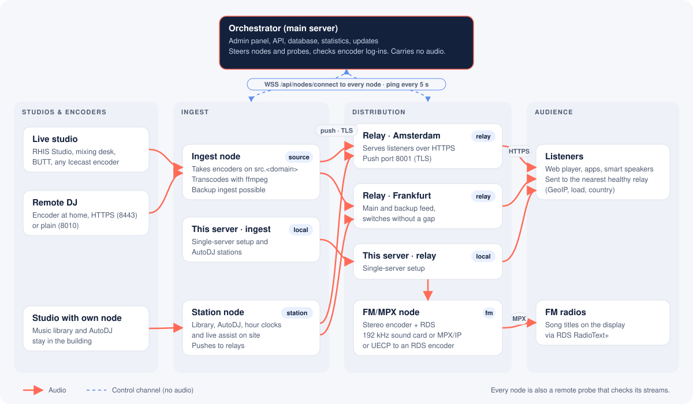
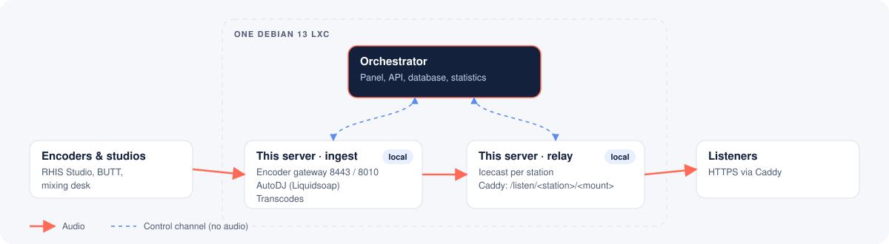
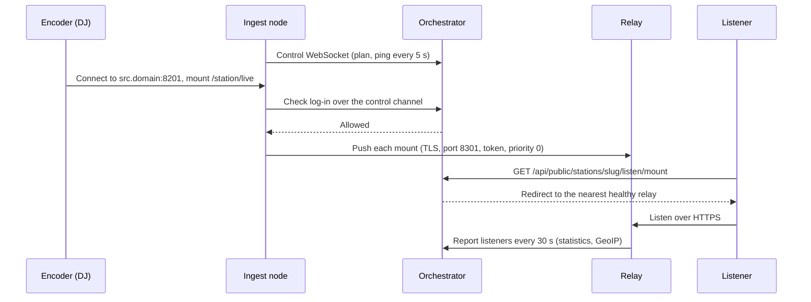

<p align="center">
  <picture>
    <source media="(prefers-color-scheme: dark)" srcset="brand/logo/rhis-logo-wit.svg">
    
  </picture>
</p>

<h1 align="center">Hosted Radio Station</h1>

<p align="center">
  A fast, multi-tenant radio platform that installs natively on Debian 13, without Docker.<br>
  Streaming, AutoDJ, hour-clock scheduling, statistics, public pages and a distribution network of nodes, in one panel.
</p>

<p align="center">
  <a href="docs/installation.md">Installation</a> ·
  <a href="docs/nodes.md">Nodes</a> ·
  <a href="docs/station-nodes.md">Station nodes</a> ·
  <a href="docs/studio.md">RHIS Studio</a> ·
  <a href="docs/fm.md">FM/MPX</a> ·
  <a href="docs/hosted-service.md">Hosted service</a> ·
  <a href="ROADMAP.md">Roadmap</a>
</p>


## What it is for

Hosted Radio Station runs radio stations for many customers on your own servers. It was built first for stations such as
Harder.FM and Radio Schermer, and is also sold as a hosted service. Customers, stations, DJs, billing and the
network that carries the audio are all managed from one panel. The panel is in English and Dutch, with a light and a
dark theme.

There are two editions per station. A station can move from Distribution to Radio station at any time.

| Edition | What you get |
| --- | --- |
| **Distribution** | Streaming only: live input from your encoders, transcoded mounts, a local Icecast or your own external Icecast/Shoutcast, statistics and public pages |
| **Radio station** | Everything in Distribution, plus the AutoDJ (Liquidsoap) with its queue, the music library and the hour-clock scheduler |

Highlights:

- **Native install** in a Proxmox Debian 13 LXC (or any Debian 13 machine), with systemd services and a single `hrs` command.
- **Multi-tenant.** Customers have their own users, roles, domains (`stream.<domain>`, `src.<domain>`), limits and optional single sign-on (OIDC/SAML).
- **Live and AutoDJ.** Encoders connect over HTTPS (8201) or plain (8200). The AutoDJ plays playlists, hour clocks with news, commercials and jingles, and requests.
- **Statistics with GeoIP**: listeners, sessions, countries, devices and song history.
- **Public pages and embeds**: a station page, a player, history, requests and on-demand.
- **Distribution network.** Relay, ingest, station and FM nodes are steered by the orchestrator, with a 3D or 2D topology view.
- **RHIS Studio**, a Windows client for live assist, cart walls and going live through a real mixing desk.
- **FM/MPX with RDS** for a real transmitter.
- **Hosted service** with packages, subscriptions, invoices, Mollie, a provisioning API and webhooks.
- **Built in**: backups (full and incremental) to FTP, FTPS, SCP and OneDrive, with restore, plus your own SMTP server. Updates come from the panel, with a production channel (`main`) and a test channel (`test`).

## How it fits together

<picture>
  <source media="(prefers-color-scheme: dark)" srcset="docs/diagrams/architecture-dark.svg">
  
</picture>

The platform has two kinds of traffic, and they never mix:

- **Control** (dashed blue): the orchestrator talks to every node over one secure WebSocket. It tells a node which
  roles and stations it has, checks encoder log-ins and collects health and statistics. It carries no audio.
- **Audio** (coral): audio flows from the studio to an ingest point, from there to the relays, and from the relays to
  listeners and FM transmitters.

Because of that split, the orchestrator can be busy, restarting or briefly offline while stations stay on air.

### The orchestrator

The orchestrator is the main server you install first. It holds:

- the **panel and API**: customers, users, stations, mounts, DJ accounts, packages and invoices;
- the **database** (PostgreSQL) and the cache (Valkey);
- **statistics**: every relay reports its listeners, and the orchestrator stores them with GeoIP and the song history;
- **routing**: per station it decides the main ingest, an optional backup ingest and the relays that carry it;
- **node management**: pairing, roles, updates, health and the topology view;
- **listener redirect**: a player asks `/api/public/stations/<slug>/listen/<mount>` and is sent to the nearest healthy
  relay, by country, load and health.

### The nodes

A node is a small Debian 13 machine (usually an LXC) with the `hrs-node` agent. You pair it once, and then it gets its
roles from the panel. A node can have more than one role.

| Role | What it does |
| --- | --- |
| **Relay** | Serves listeners. It pulls the station's public mounts from the main server, or receives them pushed by an ingest or station node on its push port (8301, TLS). With a main and a backup feed, it plays the main feed and switches to the backup without dropping listeners. |
| **Source (ingest)** | Takes encoders on `src.<domain>` (8201 TLS / 8200), checks log-ins with the orchestrator, makes the transcoded mounts with ffmpeg and pushes every public mount to the relays. It can be a station's main or backup ingest. |
| **Station node** | Runs complete stations at the customer's site: the music library, AutoDJ, hour clocks, scheduler and live assist stay in the building. It pushes its audio to relays, so listeners never connect to the studio. If the internet drops, it keeps playing. See [station-nodes.md](docs/station-nodes.md). |
| **FM/MPX** | Takes a station's stream and makes the complete FM multiplex: stereo encoder, RDS with RadioText+, pre-emphasis and a limiter. It outputs to a 192 kHz sound card, MPX over IP, or UECP to an existing RDS encoder. See [fm.md](docs/fm.md). |
| **Remote probe** (every node) | Checks its stations' streams on the main server and the relays, and reports availability and time to first byte. |

On a **single server** the same machine runs the orchestrator and the ingest and relay roles next to each other. You
can add nodes later without reinstalling.

<picture>
  <source media="(prefers-color-scheme: dark)" srcset="docs/diagrams/single-server-dark.svg">
  
</picture>

## How they communicate

| What | From → to | How |
| --- | --- | --- |
| Pairing | node → orchestrator | `POST /api/nodes/pair` with a one-time code from the panel (valid 24 hours). The node gets its id and secret, stored in `/etc/hrs-node/node.json`. |
| Control channel | node → orchestrator | WebSocket `wss://<server>/api/nodes/connect`. It carries the node's plan (roles, stations, mounts, relay targets), encoder log-in checks, and update and apply commands. A ping goes out every 5 seconds; the round trip and lost pings are shown in the panel. |
| Reports | node → orchestrator | `POST /api/nodes/agent/report` every 30 seconds with `Authorization: Node <id>.<secret>`: CPU, memory, traffic, listeners per mount and probe results. |
| Audio, pull | relay → main server | The relay pulls a mount from the main server's listen route over HTTPS. This is the classic single-ingest setup. |
| Audio, push | ingest/station node → relay | An Icecast `PUT` over TLS to the relay's push port (8301), with a token per mount. `X-Hrs-Priority: 0` marks the main feed and `1` the backup. Titles go with `/admin/metadata`. |
| Station package | station node ↔ orchestrator | The node long-polls `GET /api/nodes/agent/station/package` for settings, mounts, DJs and relay targets. It posts its own changes and state to `POST /api/nodes/agent/station/mirror` every few seconds. |
| Panel tunnel | orchestrator → station node | A WebSocket at `/api/nodes/agent/station/tunnel` passes panel and public-page requests for the node's stations (library, playlists, clocks, queue) to the node. |
| Listeners | player → orchestrator → relay | `/api/public/stations/<slug>/listen/<mount>` redirects the player to the nearest healthy relay. |

A live broadcast from a DJ on an ingest node, step by step:



What happens when something fails:

- **The orchestrator is offline.** Nodes keep playing with their last plan. A DJ who logged in during the last 12 hours
  can still go on air, and the broadcast is reported once the orchestrator is back.
- **The main ingest falls away.** The relays switch to the backup ingest without dropping listeners.
- **A relay goes down.** New listeners are redirected to the next healthy relay. Spare relays step in when none of the
  chosen ones is online.
- **A station node loses its internet connection.** The station keeps running on site. The panel shows the last
  reported state as read-only until the node is back.

## Installation

Create a Debian 13 LXC on Proxmox with the community script, then run the installer inside it as root:

```bash
# on the Proxmox host
bash -c "$(curl -fsSL https://raw.githubusercontent.com/community-scripts/ProxmoxVE/main/ct/debian.sh)"

# inside the container
bash -c "$(curl -fsSL https://raw.githubusercontent.com/rhisijmuiden/hosted-radio-station/main/install.sh)"
```

A menu asks what to install: **Orchestrator** (panel and control plane, audio on nodes), **Node** (the bare node
agent) or **All-in-one** (orchestrator with its own ingest and relay). For an orchestrator it asks for the web server
mode (built-in Caddy with Let's Encrypt, or behind your own reverse proxy), the domain, the update channel and the first
administrator. See [installation.md](docs/installation.md) for every option.

To add a node, run the same installer on a fresh Debian 13 LXC and choose **Node**: it shows a code, and you accept the
node under **Nodes → Pending nodes**. Or click **Add node** in the panel and run the command it shows:

```bash
curl -fsSL https://raw.githubusercontent.com/rhisijmuiden/hosted-radio-station/main/install-node.sh \
  | bash -s -- --server https://radio.example.com --code XXXX-XXXX-XXXX
```

For an FM node, use `install-fm.sh` with the same options. See [nodes.md](docs/nodes.md) and [fm.md](docs/fm.md).

### Ports

Every role has its own incoming ports (the port plan, 1.3), so roles on one machine never clash and a server is easy to put behind a firewall or in a DMZ. Every port of a node can be changed in its settings; the panel shows the firewall rules per node under **Nodes → node → Firewall**.

| Role | Incoming ports (TCP) |
| --- | --- |
| Orchestrator | 443 (+80 for certificates); with its own ingest also 8200/8201, 2022 (SFTP), 21 and 50000–50100 (FTP) |
| Ingest | 8200 plain, 8201 TLS, 8210–8299 Shoutcast v1 (only when switched on per station) |
| Relay | 80/443 for listeners, 8301 (TLS) for pushes from ingests and station nodes |
| Station node | 8400 plain and 8401 TLS (RHIS Studio and Go Live), 8402 SFTP |
| FM/MPX | none, outgoing only |

**Old ports.** Servers and nodes installed before 1.3 keep the ports they used (8010 and 8443 for encoders, 8001 for pushes, 2022 for SFTP on station nodes, 8100–8199 for Shoutcast v1) open next to the new ones, and pushes keep going to 8001, until the administrator switches them off under **Nodes → Port plan** (everywhere, or per server). Open the new ports in the firewalls first; the firewall check on each node shows whether they are reachable.

### Commands and paths

| | Main server | Node |
| --- | --- | --- |
| Command | `hrs` (`hrs update`, `hrs status`, `hrs logs`) | `hrs-node` (`hrs-node update`, `hrs-node logs`) |
| Code | `/opt/hosted-radio` | `/opt/hrs-node` |
| Configuration | `/etc/hosted-radio/hosted-radio.env` | `/etc/hrs-node/node.json` |
| Data | `/var/lib/hosted-radio` | `/var/lib/hrs-node` |

## Screenshots

| | |
| --- | --- |
|  |  |
| Station overview with live encoder details | Statistics with GeoIP listener map |
|  |  |
| AutoDJ with queues Q1 and Q2 | Hour clock editor |
|  |  |
| Network topology in 3D | Network topology in 2D, with latency |
|  |  |
| Nodes with status, version and latency | Health of a node over time |
|  |  |
| Public station page | RHIS Studio, live assist |
|  |  |
| Backups with remote locations | FM/MPX node with RDS |

More screenshots per phase are in the [roadmap](ROADMAP.md).

## Technology

Debian 13 · systemd · Caddy · Node.js 22 with TypeScript and Fastify (API) · React (panel) · PostgreSQL · Valkey ·
Icecast · Liquidsoap · ffmpeg · SFTPGo · restic and rclone (backups) · GeoIP (DB-IP or MaxMind)

| Folder | Contents |
| --- | --- |
| `apps/api` | API, orchestrator and background jobs |
| `apps/web` | Admin and customer panel, public pages |
| `apps/node` | Node agent (`hrs-node`) |
| `apps/studio` | RHIS Studio, the Windows client |
| `brand` | RHIS house style: logo and design tokens |
| `deploy` | systemd units and the `hrs` helper scripts, for the server and the node |
| `docs` | Documentation, diagrams and screenshots |

## Roadmap

The platform is built in phases. **Version 1.0.0** contains phases 1 to 13: everything from streaming, AutoDJ and the
scheduler to station nodes and the orchestrator as a pure control plane. Orchestrator redundancy, Cloudflare DNS
integration and a guided installer follow as 1.x updates. See [ROADMAP.md](ROADMAP.md) and the
[changelog](CHANGELOG.md).

---

<p align="center"><sub>Powered by RHIS</sub></p>
