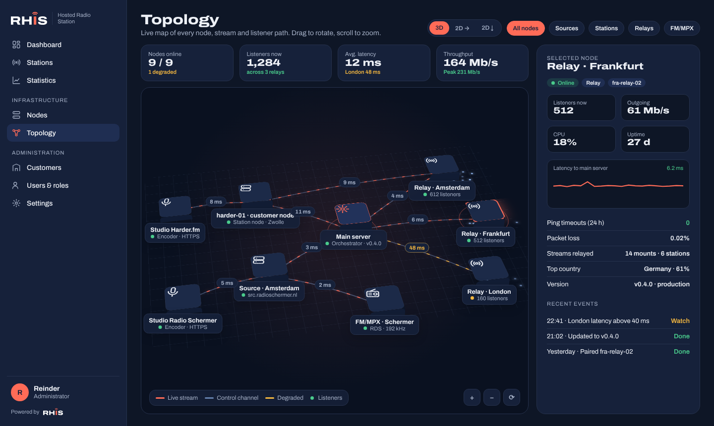
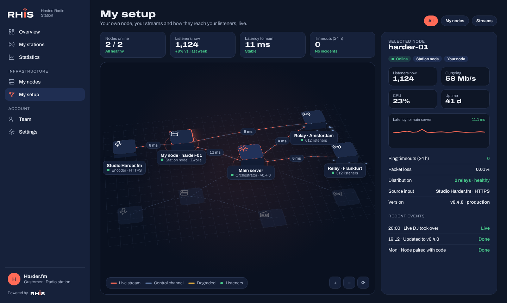
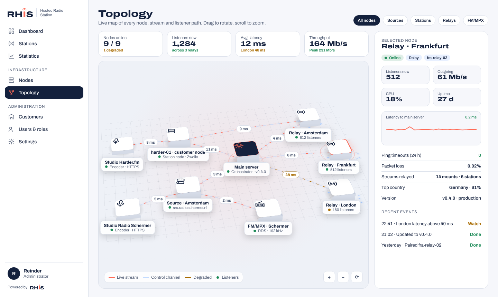

# Roadmap

Hosted Radio Station is a fast, self-hosted radio platform: streaming, live DJs, AutoDJ, scheduling, statistics and public player pages. It serves many stations and customers from one installation. It installs **natively** in a Debian 13 LXC container, without Docker.

It comes in two editions that customers can upgrade between:

| Edition | What you get |
| --- | --- |
| **Distribution** | Streaming (local Icecast or your own external Icecast/Shoutcast server), live input, statistics and public pages |
| **Radio station** | Everything in Distribution, plus the AutoDJ, dual queues and the hour-clock scheduler |

We build the platform in phases. Each phase ends in a working release on the `test` branch and then moves to `main` (production). There is no finish line: new phases are added as the product grows.

Powered by [RHIS](https://rhis.nl).

## Preview

Phase 1 as it runs today: the admin panel in the RHIS house style, light and dark, English and Dutch.

| Light | Dark |
| --- | --- |
|  |  |
|  |  |
|  |  |

Phase 2: backups, restore, single sign-on per customer and the audit log.

| Light | Dark, Dutch |
| --- | --- |
|  |  |
|  |  |
|  |  |
|  |  |

Phase 3: stations with live encoders, mounts and conversions, external servers, DJ accounts, customer domains and limits.

| Light | Dark, Dutch |
| --- | --- |
|  |  |
|  |  |
|  |  |
|  |  |
|  |  |

Phase 4: statistics with real listener addresses, GeoIP, devices, songs and broadcasts.

| Light | Light |
| --- | --- |
|  |  |
|  |  |
|  |  |

Phase 5: public station page with live now playing, embeddable widgets, song requests and on demand.

| Listeners | Panel |
| --- | --- |
|  |  |
|  |  |
|  |  |
|  | |

## Status

| Phase | Name | Status |
| --- | --- | --- |
| 1 | Foundation | Done |
| 2 | Administration and security | Done |
| 3 | Distribution | Done |
| 4 | Statistics | Done |
| 5 | Public pages | Done |
| 6 | Radio station (AutoDJ) | Planned |
| 7 | Scheduler | Planned |
| 8 | Distribution network and orchestration | Planned |
| 9 | Windows client | Planned |
| 10 | Hosted service | Planned |
| 11 | FM/MPX and RDS module | Planned |
| 12 | Open source edition | Planned |

## Phases

### Phase 1: Foundation

The base server that everything else builds on.

- `install.sh` that turns a fresh Debian 13 LXC (created with the [community-scripts Debian LXC](https://github.com/community-scripts/ProxmoxVE)) into a running server: systemd services, PostgreSQL, Valkey, Caddy and Node.js. No Docker.
- REST API with OpenAPI documentation and API keys. Everything the admin panel does is also available through the API.
- Sign-in, customers, users and roles (administrator, customer, DJ).
- Admin panel in the RHIS house style: menu on the left, English and Dutch, light and dark theme, "Powered by RHIS" in the sidebar.
- Info button with the current version, update check, one-click update from the UI, and switching between the production and test channels.
- Built-in HTTPS (Let's Encrypt), or running behind your own reverse proxy with trusted proxy headers.
- Brought forward from phase 2: outgoing mail server settings (STARTTLS/TLS, DKIM) with a test e-mail.

Install it on a fresh Debian 13 LXC with the [installation guide](docs/installation.md).

### Phase 2: Administration and security

The standard building blocks of every installation.

- Configurable outgoing mail server (SMTP with STARTTLS/TLS and DKIM) with branded e-mail templates in English and Dutch: password reset, invitations, backup and restore reports.
- Backup and restore of the database, the data folder and the server configuration, full and incremental, to FTP, FTPS, SFTP/SCP, OneDrive or a local folder (e.g. a mounted NAS). Encrypted and deduplicated with restic, with a schedule, retention, a recovery key per location, e-mail reports and `hrs backup` on the shell.
- Restore from any remote location from the panel: pick a backup and choose database, files and/or configuration.
- Single sign-on per customer (OpenID Connect and SAML 2.0, e.g. Microsoft Entra ID, Google, Keycloak, ADFS) with allowed e-mail domains, optional account creation on first sign-in and an optional password fallback.
- Audit log of every change and sign-in, with filters, CSV export and a retention setting. Customers see the activity of their own account.
- Invitations and "forgot password" by e-mail.

### Phase 3: Distribution

The first edition you can offer to customers.

- Stations in the Distribution or Radio station edition, with a one-click upgrade when the customer's plan allows it.
- Each station runs its own Icecast server on the container (bound to 127.0.0.1, behind Caddy at `/listen/<station>/<mount>`), and can also send to or watch external Icecast and Shoutcast v1/v2 servers, with titles and listener counts.
- Mount points with bitrates and formats (MP3, AAC, Opus, Vorbis), converted mounts made with FFmpeg, fallback mounts and per-mount listener limits.
- Live DJ accounts with full live broadcasts: encoders connect over TLS (port 8443) or plain Icecast (8010), and old Shoutcast v1 encoders get their own port per station. Every broadcast is logged (who, when, how long, why it ended); managers can disconnect an encoder, and encoders above the bitrate limit are refused.
- Own domains per customer: `stream.<domain>` for the panel, pages and streams, `src.<domain>` for encoders. Certificates are only issued for domains that are added and verified (CNAME or A/AAAA) in the panel.
- Media upload over SFTP, SCP, FTP and FTPS (SFTPGo), logging in with the DJ account, straight into the station's media folder with the customer's storage quota.
- Limits per customer: stations, listeners, bitrate and storage, with a usage overview.
- The data model allows several outputs per station, ready for the nodes and relays of phase 8.

### Phase 4: Statistics

Insight into who listens, where and for how long.

- Every listening session is stored with the listener's real address (passed on by Caddy, also behind your own reverse proxy via trusted proxies), shortened by default for privacy. Unique listeners are counted with a keyed hash.
- Location (country, region, city, network) from a GeoIP database on the server: DB-IP Lite out of the box (no account, monthly update) or MaxMind GeoLite2 with a license key. Updated automatically and left out of backups.
- Device, player/app and operating system for every session, with bots and short "connect checks" left out.
- Listener counts every minute per station, mount and external output, rolled up per hour for long periods. External Icecast and Shoutcast servers are counted too, and with their admin password their listeners get a location as well.
- Live tab, overview (listening hours, average and peak listeners, unique listeners, listening time, compared with the previous period), weekday × hour heatmap, listening time bands, world/Europe map with countries and cities, devices and players, mounts, referring websites, most played songs with how the audience moved, live broadcasts with their audience, and a list of sessions.
- Per station, per customer or for everything, any period, with CSV export of every table and a "Listening now" tile on the dashboard.
- Settings for privacy, retention per data type and the GeoIP source.
- Plain PostgreSQL instead of TimescaleDB: per-minute samples plus hourly rollups make a 30-day report on 400,000 sessions take about two seconds, and backups and restores keep working without an extra database extension.

### Phase 5: Public pages

What listeners see.

- A public page per station at `/public/<station>` (also on the customer's own `stream.<domain>`): a big player with album art, the DJ who is live, listeners, quality choice and volume, recently played, song requests, on demand, about and social links, sharing, a mini player while scrolling and lock-screen controls. Light and dark, English and Dutch, with the station's own logo and accent colour and "Powered by RHIS". Links shared on social media get a proper preview.
- Widgets for other websites: the player as a bar or a card, recently played and the request form, with theme, language, accent colour and a transparent background. The panel makes the embed code with a live preview.
- Now playing in real time over Server-Sent Events and WebSocket, and a public JSON API (now playing, history, on demand, requests) that any website can call. Converted mounts such as `/opus` carry the title of their source.
- Album art looked up for every song (iTunes Search) and kept on the server, so listeners never contact a third party.
- Song requests with an inbox for DJs in the panel, optionally only while a DJ is live, limited per listener.
- On demand: live DJ sets are recorded automatically (within the customer's storage limit) and published right away or as a draft; audio files uploaded over SFTP/FTP into the `ondemand` folder appear by themselves.

### Phase 6: Radio station (AutoDJ)

The upgrade from Distribution.

- Media library on local storage, SMB or NFS, with bulk import of existing music collections.
- Liquidsoap per station: playlists, crossfades and two queues (Q1 and Q2) with configurable rules for which queue plays next.
- One-click upgrade from Distribution to Radio station.

### Phase 7: Scheduler

A tightly programmed station.

- Hour clocks, for example news on the hour, then commercials, then one or two songs.
- Weekly schedule that decides which clock runs when.
- Live takeover with automatic fallback to the AutoDJ.

### Phase 8: Distribution network and orchestration

Scale out with remote nodes; the main server becomes the orchestrator.

- One universal node package: its own Debian 13 LXC with an installer that installs a small node agent.
- Pairing: create a node in the panel, run the installer with the one-time pairing code, and the node connects to the main server over an authenticated, encrypted channel. Nodes can be paired first and get a role later; unpairing and re-pairing is possible.
- Roles assigned from the panel and rolled out by the agent: **source server** (where encoders and studios deliver), **relay** (where listeners connect), and later **station node** (runs stations, AutoDJ and DJ ingest for selected customers) and **FM/MPX** (see phase 11).
- Dedicated customer nodes: place a customer on its own server or LXC. The orchestrator tells each node where its sources come in and where listeners connect, and keeps DNS names (`src.` and `stream.`) pointing at the right node.
- Nodes overview in the admin panel: status, role, version, load, bandwidth and listeners per node, merged into the station statistics with GeoIP.
- Topology view: an interactive, modern 3D-style map (WebGL) of how studios, source servers, stations, relays and listeners connect, with animated stream flows and live health, latency, ping timeouts and packet loss between each node and the main server.
- Bring your own node: customers can register their own node. It shows up in their customer panel with the same topology view, limited to their own setup: node health, distribution status and connection quality to the main server.
- Updates come from the main server: nodes follow the main server's version and channel, and update from the panel.
- Remote probes that monitor stream availability from other locations.

Design preview of the topology view: the administrator sees every node, a customer sees only their own setup.

| Administrator (dark) | Customer, own node (dark) |
| --- | --- |
|  |  |

### Phase 9: Windows client

Live assist from the studio PC.

- Control Q1 and Q2, play live and broadcast from the PC.
- Talks to the server through the API and a direct audio channel.
- Sound card passthrough: pick any input of the studio sound card (ASIO/WASAPI) and send it live to the server, so studios can broadcast from a real mixing desk.

### Phase 10: Hosted service

The commercial layer.

- Packages for both editions, customers created automatically from the RHIS website through the API, and later billing.

### Phase 11: FM/MPX and RDS module

A separate LXC package for FM broadcasters.

- Runs as the FM/MPX role on a node: its own Debian 13 LXC with the node installer, paired with a one-time pairing code and updated from the main server.
- Receives a station stream and generates a complete MPX signal (stereo encoder plus RDS).
- RDS PS, RadioText and RadioText+ filled automatically from now-playing data, so FM receivers show the right song titles.
- Output through a 192 kHz sound card or as MPX over IP, or control of an existing RDS encoder over UECP.

### Phase 12: Open source edition

A community edition on its own branch.

- "Powered by RHIS" built in by default, with the house style (logo, colours, fonts) customisable per installation.
