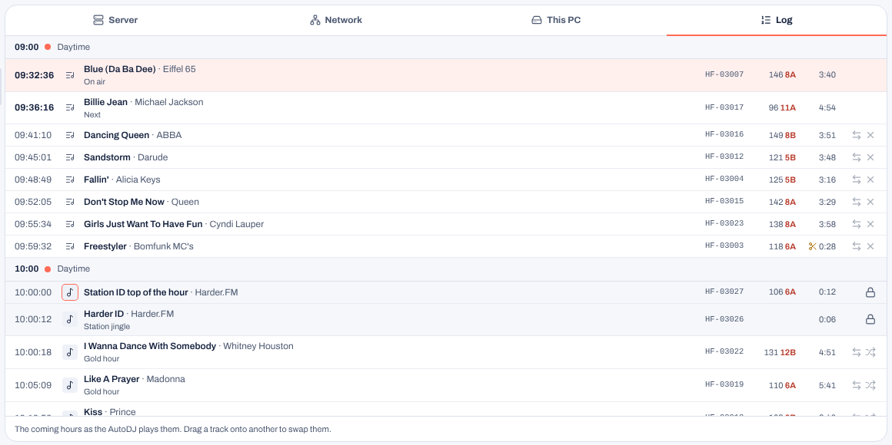
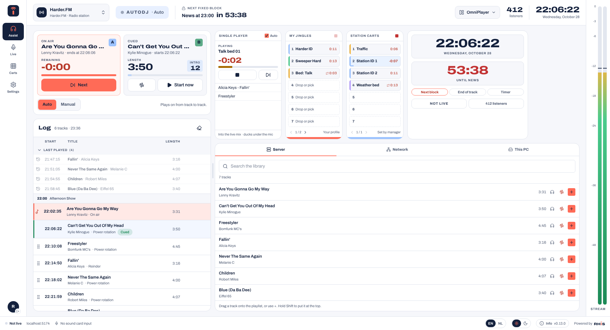
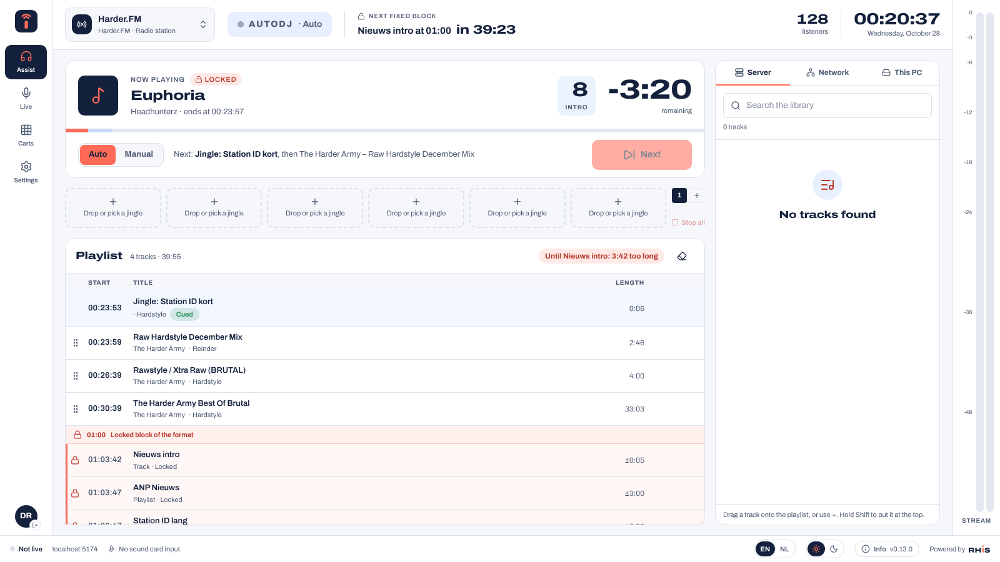
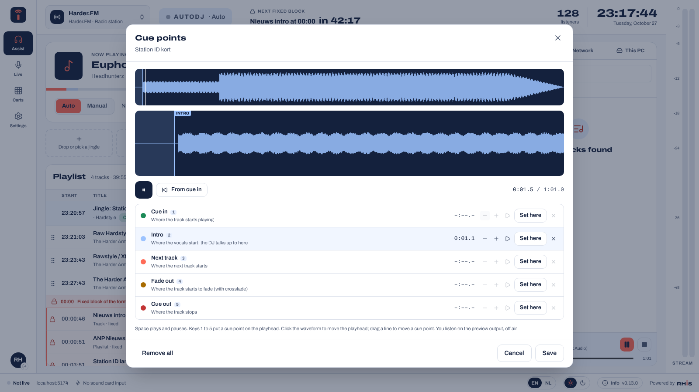
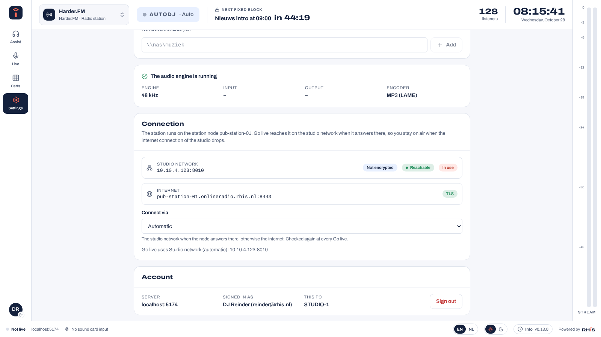
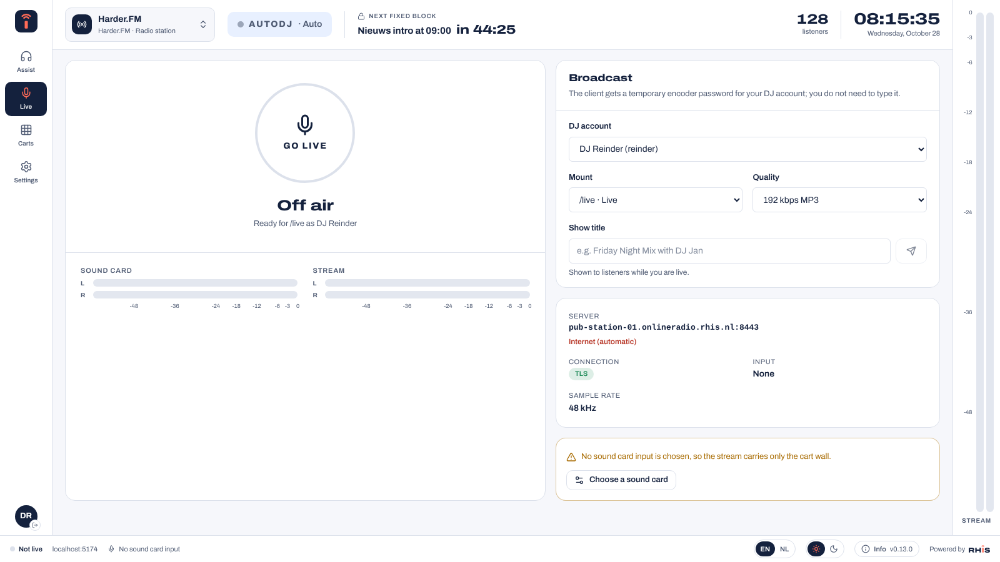

# RHIS Studio (Windows client)

RHIS Studio is the studio PC client of Hosted Radio Station: live assist for the AutoDJ queues, live broadcasting from
any sound card input (also a mixing desk), and a cart wall. It talks to the server through the same API as the admin
panel and sends its audio to the server's source ingest, like any Icecast encoder.

## Install

1. In the admin panel open **Windows client** in the left menu and download the installer of the **Production**
   channel (or **Test** for the newest test build).
2. Run it. The installer is not code-signed yet, so Windows SmartScreen asks once: choose *More info* → *Run anyway*.
   It installs for the current user, without administrator rights.
3. Start **RHIS Studio**, enter the address of your panel (for example `radio.example.com`) and choose
   **Sign in with your browser**. Your browser opens the panel; check that it shows the same code as the client and
   choose **Link this PC**. The client signs in by itself.

The PC gets its own API key, kept in the Windows Credential Manager. Linked PCs are listed on the **Windows client**
page, where you can unlink them; **Sign out** in the client revokes its key too.

## Live assist

For stations with the Radio station edition. The screen has a narrow menu on the left (Assist, Live, Carts,
Settings, and your account at the bottom) and a status bar at the bottom: the connection of your broadcast, the
server and quality, the sound card input, the language, the theme and **Info**.

The **top bar** shows the station (click it to switch), who is on air (you, another DJ, or the AutoDJ in Auto or
Manual), the **next fixed block** of the format (news, commercials) with a countdown, the listeners and the clock.

The **player** shows what is on air, when it ends and the time left in large figures, and on the line below it what
comes next. **Next** starts the next line of the playlist at once (in Auto it skips the track on air).

Below the jingle buttons is the **playlist**: one queue (server 1.3 and later), with the time each line starts.
Drag tracks to reorder them, or use the buttons that appear on hover (to the top, remove). The eraser empties the
rotation; requests and tracks added by hand stay. Search the library on the right and drag a track onto the
playlist, or use **+** (Shift = at the top); see *Library and preview* below.

The fixed blocks of the hour clock sit in the playlist at their minute, with a clock icon and their expected length.
A block on the minute (*hard*) cuts the track that runs into it; another block waits for that track to end. The header
**backtimes** to the next block: how much the track that runs into it is too long, or how much the playlist is too
short to reach it. The lengths of news and commercials are estimates (the average track of their playlist).

### OmniPlayer layout

**Layout** in the top bar (on the Assist page) switches between **Classic**, described above, and **OmniPlayer**, a
layout like the OmniPlayer playout software. The choice is kept in your **DJ profile** on the server, so every studio
PC you sign in on shows the same layout (an older server keeps it on this PC only).

- **Players A and B** follow the playlist on the server: one has the track on air (time left, intro counter, ends
  at, **Next**, and **Stop** in Manual), the other the cued track that goes on air next (length, intro, start time).
  At every new track they swap roles, like two players on a desk. **Start now** on the cued player starts it at
  once; in Manual, while the player waits, it is **Play**. Drop a track on the player on air to play it now, or on
  the cued player to put it at the top of the playlist.
- The **log** under the players: the last five tracks played (fold them away with the arrow), the track on air in
  coral, then the playlist with a header for every hour, with the show (or else the hour clock) planned then. The
  cued track has a green edge. Everything else works as in the playlist of Classic.
- The **dashboard**: a big clock and a big red countdown to the **next fixed block**, the **end of the track** on air,
  or your own **timer** (set it with − and + in steps of 30 seconds, start, pause, reset). Your choice and the length
  of the timer stay in your profile.
- **My jingles**: your own jingle buttons, the same as in Classic, here as a column of seven with pages. Click to
  play, again to stop; drop a file or a library track on a button, or click an empty one; the pencil edits it.
- **Station carts**: the second grid, filled by a manager in the panel (*Programme > Station carts*) and the same for
  every DJ of the station, such as station IDs, traffic and a weather bed. In Studio they only play.
- The **single player**: a player of its own on this PC with a short list, for a bed under a talk or a track from a
  USB stick. Drag tracks onto it from the library, a share or *This PC*. **Play** starts the first track, again stops
  it; the next button goes to the next track. A track that ends leaves the list and the next one waits, or starts by
  itself with **Auto**. Like the jingles it plays into the broadcast when you are live, and it goes 12 dB down while
  the sound card input has sound (switch it off under *Settings > Audio*, *Single player under the mic*). The list
  stays on this PC.
- The **news player**: the next news time of the hour clocks with a countdown, and whether the bulletin is ready
  (green) or the spare jingle will play (amber). While you are live it plays the news into the broadcast: with
  **Auto** at the news time, otherwise with **Start news**. The news is a fixed block, so only managers and owners can
  stop it. When you are not live the AutoDJ plays the news itself. The source, the times and the spare jingle are set
  in the panel (*Programme > News* and a *News* item in the hour clocks). It needs a server with the news bulletin.
- The **library** sits under them, as a table: the station's own **code** of the track (such as HF-03007), title and
  artist, the **ISRC** when the window is wide enough, **BPM** and **key** with its Camelot code (8A, 5B: neighbours
  on the wheel mix well), and the length. Click a column header to sort, again to turn the order around. The search
  also finds codes and ISRCs. Codes, tempo and key come from the server: it reads them from the tags and measures
  tempo and key where the tags have none; managers correct them in the panel (*Library > Edit tags*).
- The **log editor** is the *Log* tab of the library: the coming three hours as the AutoDJ plays them, with the hour
  clocks run ahead (the panel has the same under *Programme > Log editor*, up to six hours). Drag a track onto another
  to swap them. The arrows of a row switch to the *Server* tab, where **+** places the track you pick on that row;
  the dice pick another track, the cross takes a queue track out. Locked parts of the format (a lock) and what the
  player loaded already stay as they are. The AutoDJ plays exactly the log; when the timing shifts (a live show, a
  skip), it moves along. It needs a server with the log editor.

  

In the **Layout** menu each panel goes on or off (last played, single player, news player, my jingles, station carts, dashboard,
library). Drag the handle between
the players and the panels to change their width (double-click it, or *Reset* in the menu, for the default). It
needs a server that knows the DJ profile and the last played tracks; with an older one the log shows no last played
tracks.



### Manage view

Managers and owners of a Radio station get a third view in the layout menu: **Manage** (Ctrl+3; Ctrl+1 is Classic,
Ctrl+2 OmniPlayer). It sets up the station from Studio on the same data as the web panel, with a menu on the left:

- **Overview**: listeners now, who is on air (AutoDJ with its hour clock, or the DJ), how many of the station's nodes
  are healthy, the delivery path (via the ingest or direct to the relays), the coming hours of the format and what
  needs attention (a node offline, a failing monitoring check, a relay mount that does not connect, a firewall
  problem). A click on a tile or a line opens its section.
- **Nodes**: the station node, ingests and relays the station uses, with status (Standby is a backup ingest that is
  ready but does not carry the station now), CPU, RAM, the monitoring checks of this station, the firewall and the
  version with its commit. The recorders that record the station are listed too.
- **Hour clocks**: the clocks as chips (the one on air first) and the hour as a donut with a slice per item. Edit the
  items like in the panel (minute, type, playlist and number of tracks, name, *Exactly on the minute*, *Locked*, order),
  then **Save clock**; **Duplicate** makes a copy to change on its own.
- **Weekly schedule**: the week as a grid, each block in the colour of its hour clock (live shows in coral). Click an
  empty spot or **Add show** to add a block, click a block to change it, or drag it up or down to move it in steps of
  15 minutes. The schedule settings are below the grid.
- **Playlists & categories**: the playlists that feed the rotation and the ones only hour clocks use (news, ads,
  jingles). Add or edit one (folders, order, weight), switch it on or off, or delete it.
- **Rotation rules**: the AutoDJ settings of the panel: on/off, tracks in the queue, artist and track separation,
  crossfade, the mount it follows, normalise, pause while a DJ is live, requests, the prefix of the track codes and
  tempo/key analysis. **Save** applies them, **Undo changes** goes back to what is saved.
- **Library folders**: the folders of the station storage and every share, with their tracks and the playlists that
  use them (orange: the folder itself, grey: through a parent folder). The list button on a row makes a new playlist
  from that folder; **Scan for new files** looks for new, changed and removed files. Shares are managed in the panel.
- **Audio routing**: the path of the audio now (studio or encoders → ingests → relays → listeners; coral lines carry
  the station, dashed lines stand by) and the route settings of the panel: delivery for a station node (via the
  ingest or straight to the relays), main and backup ingest, and the relays (automatic or chosen, with spare relays).
  **Apply** asks first and then switches the streams within seconds. Only the owner can change the route.
- **DJs & live access** comes into Studio in the next step; until then it opens at the same place in the web panel.

The bar at the bottom shows the track on air with its remaining time and goes back to the player. The view is kept in
the DJ profile like the layout. It needs server 1.6 (the `manage` feature); with an older server, or for a DJ, the
menu only has Classic and OmniPlayer.

### Locked blocks

An item of the hour clock can be **locked** (panel: *Hour clocks*, the *Locked* box on a playlist or track item), for
example jingle, news, jingle. In the playlist a locked block has a lock. While a locked item is on air the player
says *Locked*, and DJs cannot skip it (**Next** is off) or play something else over it (dropping on the player). The
music the DJ adds waits in the playlist until the block is over. Managers and owners can still skip it after a
question, in Studio and in the panel. It needs server 1.3.



### Auto and Manual

- **Auto**: the AutoDJ plays on from track to track.
- **Manual**: after each track the player waits, silent, until you press **Play**. The next track is already cued, so
  it starts at once. **Play** while a track plays starts the next one when it ends; **Next** starts it right away;
  **Stop** ends the track on air (with the crossfade of the station) and waits.

Manual stays on only while a studio PC is connected: the client checks in every 10 seconds. When it closes or loses
its connection, the server goes back to Auto by itself after 30 seconds and plays on with what is in the queues.
Hard timed items of the hour clock (news on the hour) still start on their minute in Manual.

The level meter at the right edge shows the stream this PC sends while you are live.

The countdown, the fixed blocks and backtiming need server 1.1 or newer (expected lengths: 1.3); on an older server
the client says the server needs an update.

### Library and preview

The panel on the right has three sources:

- **Server**: the station library. Search, drag a track onto the playlist or use +.
- **Network**: the network shares you added under *Settings › Network shares* (for example `\\nas\music`). They
  open with the Windows sign-in of the PC, like in Explorer.
- **This PC**: the drives of the PC, including a USB stick and mapped network drives.

The headphones button plays a track on the **preview output** (*Settings › Preview*), off air: never in the stream
and not on the output of the cart wall unless you choose the same sound card. The bar at the bottom of the panel has
pause, stop and a position slider.

Drag a track onto the **player** (the Now playing card) to play it now: from the playlist, the library or this PC. The track
on air fades out and the dropped track starts at once, in Auto and in Manual. It needs server 1.1.

A file from the network or this PC goes on air through the station library: + or dragging it onto the playlist uploads
it to the library, waits until the server has read its tags and then puts it in the playlist. This needs the manager or
owner role (it counts towards the storage of the station); DJs can preview local files.

### Cue points

The waveform button on a track (in the playlist and in the server library) opens the **cue editor**. It shows the
whole track and, below it, a zoomed view around the point you work on. Five cue points, stored on the server per
track so the AutoDJ and every studio use them:

| Point | Key | What it does |
| --- | --- | --- |
| Cue in | 1 | The AutoDJ starts the track here (silence or a long count-in is skipped). |
| Intro | 2 | Where the vocals start. The player counts down to it, so the DJ can talk up the intro. |
| Next track | 3 | The segue: the next track starts here, mixed over the end of this one (with crossfade). Without crossfade the track stops here. At most 30 seconds before cue out. |
| Fade out | 4 | With crossfade: the track fades from here to cue out. |
| Cue out | 5 | The track stops here. |

Click the waveform to move the playhead, Space plays and pauses (on the preview output, off air), keys 1 to 5 put a
point on the playhead, and a line can be dragged. **Listen from here** plays from a point (a few seconds before the
segue, fade and cue out); **Hear the transition** plays the last seconds before the segue. Save stores the points; the
AutoDJ uses them from the next time the track plays. Lengths and start times in the playlist count from cue in to the
segue (or cue out), and the player shows the seconds left of the intro next to the remaining time.

Cue points need server 1.3 and the manager or owner role, like adding tracks to the library.



### Jingle buttons

Above the queues are your own jingle buttons: six on a page, more pages with **+** (up to 48 buttons). Click a button
to play it, again to stop. Fill an empty button by clicking it (choose a file), or drag a file from *This PC* or
*Network*, or a track of the server library, onto it; a file dropped on a full button replaces it. The pencil sets
the label, colour and loop, or empties the button.

The jingles are kept in your profile on the server, per station, so you get the same buttons on every studio PC. The
client downloads them once and plays them itself, like the cart wall: into the stream and/or on the output device, as
set in *Settings*. The jingles of the station itself (station IDs, news intros) come with the format from the server.
It needs server 1.1 (`/api/studio/stations/:id/jingles`, at most 25 MB per file).

## Going live

1. In **Settings** choose the driver (**WASAPI**, or **ASIO** for professional sound cards), the sound card, and the
   channels: a stereo pair such as *3 – 4* (for example the output of a mixing desk on inputs 3 and 4), or one channel
   as mono. Check the level on the meter and set the input level.
2. In **Go live** choose your DJ account, the mount and the quality (64–320 kbps MP3, up to what the mount allows),
   and type a show title if you like.
3. Press **Go live**. The client asks the server for a temporary encoder password for your DJ account (valid 12
   hours), so you never type it. It connects over TLS when the server has a certificate, and reconnects by itself when
   the connection drops. A refusal (outside your show, wrong mount) is shown and not retried.

When Windows does not trust the certificate of the encoder address (for example a name without a public
certificate yet), the client shows the error with **Connect without encryption**, if the server has a plain port.
The temporary password then goes over the network readable. The choice is kept for that address; *Try encrypted
again* under *Connection* undoes it.

### Connection to a station node

When the station runs on a [station node](station-nodes.md) in the studio, the node has two addresses: its address
on the studio network and its public address. **Settings › Connection** shows both, whether the node answers on the
studio network, and which one Go live uses. *Connect via*:

- **Automatic** (default): the studio network when the node answers there, otherwise the internet. The client checks
  again at every Go live, so a studio PC goes live over the LAN in the studio and over the internet at home, and a
  studio keeps broadcasting when its internet connection drops.
- **Studio network** or **Internet**: always that address.
- **Manual address**: an address and port of your own (for example another LAN address or a port forward), with or
  without TLS.

The studio network address is the node's *Address on the studio network* from the panel, or else the first address
the node reports. It is always plain (a LAN address has no public certificate). The public address uses TLS when it
is a public name with a certificate. The Go live page shows the address in use and how it was chosen.





DJs can only broadcast with the DJ account linked to their own user; managers and owners can use any account of the
station. The server's normal rules apply: show times, mount limits and bitrate limits.

A limiter keeps the stream below −0.5 dBFS. The mount must be an MP3 mount (the client warns otherwise).

## Cart wall

Four pages of twelve carts, played with **F1–F12** (from every screen) or a click; press again to stop. Each cart has
a file (MP3, WAV, FLAC, OGG, AAC/M4A, up to 10 minutes), a label, a colour and an optional loop. In **Settings** choose
where carts play: straight into the stream (a studio without a mixing desk), and/or on an output device (into a channel
of the mixing desk). *Listen to the input* plays the sound card input on the output device.

## Updates

**Info** (bottom left) shows the version, the update channel (**Production** or **Test**) and whether a newer build is
available. **Download and install** downloads the installer, checks its SHA-256 against the release and installs it;
the client restarts afterwards. Switching the channel to Test and back works the same way.

Builds come from GitHub Actions (`.github/workflows/studio.yml`):

| Branch | Release | Channel |
| --- | --- | --- |
| `main` | `studio-v<version>` | Production |
| `test` | `studio-v<version>-test.<run>` (pre-release) | Test |

A production release is published once per version: raise `version` in `apps/studio/package.json` for the next one.
The server lists the newest release per channel at `GET /api/studio/releases`.

## Development

```bash
cd apps/studio
pnpm dev                      # the interface in a browser, with a simulated sound card, on http://localhost:5174
pnpm tauri dev                # the real app (on Windows, or Linux with WebKitGTK)
cd src-tauri && cargo test    # audio engine, encoder and streamer tests
```

In the browser, enter `http://localhost:5174` as the server: `/api` is proxied to a local API on port 8000
(`HRS_API` changes that).

ASIO builds (`--features asio`) download Steinberg's ASIO SDK at build time and need LLVM (`LIBCLANG_PATH`).
Distributing ASIO builds outside your own organisation requires Steinberg's ASIO licence agreement.
